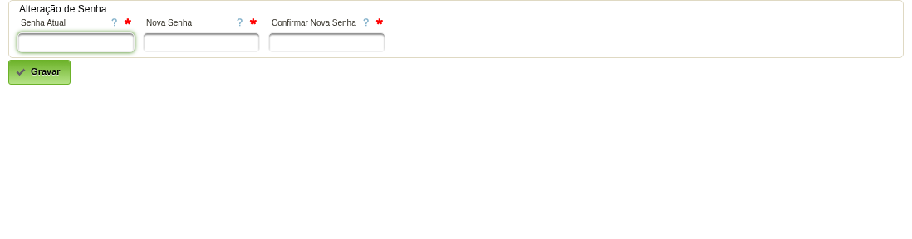

# Variante "integração LDAP": troca de senha pelo próprio AGHUse

> **Variante NÃO OFICIAL.** Modificação independente do código-fonte do AGHUse 13.250-STABLE, feita por este instalador, **sem vínculo** com a Comunidade AGHUse, o HCPA ou a EBSERH. A versão oficial continua disponível, sem nenhuma alteração, no instalador "original". Para conhecer o projeto oficial: <https://sites.google.com/hcpa.edu.br/aghuse/sobre-o-aghuse>.

> **Código-fonte da modificação:** os arquivos originais e modificados, o *patch* e os testes citados abaixo ficam no repositório, em <https://github.com/jean2020p/aghuse/tree/main/modificacoes/integracao-ldap>. Os pacotes de instalação levam só este resumo.

## 1. Objetivo

**Deixar mais fácil para o usuário e para o administrador: cada usuário troca a própria senha pela tela do AGHUse.**

No AGHUse 13.250 original:
- existe a tela **"Trocar Senha"** no menu (*Outros Módulos → Configuração → Acesso → Senha*), mas ela **não funciona**. Ao gravar, o método que deveria trocar a senha (`UsuarioON.alterarSenha`) apenas lança `UnsupportedOperationException` ("Alteração de senha no LDAP/AD não suportada");
- não há, em todo o código, nenhuma gravação de senha no diretório. A troca existia só no HCPA, por um serviço interno daquela instituição;
- no modo de login pelo banco de dados, a tela nem chega a esse ponto: a conferência da senha atual falha ("Senha atual não conferem") por um problema de transação (seção 4);
- resultado: fora do HCPA, para trocar a senha o usuário depende do administrador e da linha de comando.

Com esta variante a troca funciona nos **três modos de login** do instalador. A senha nova vale na hora, no AGHUse e em qualquer sistema ligado ao mesmo diretório.

## 2. O que muda para o usuário

| | Original | Variante |
|---|---|---|
| Menu *Configuração → Acesso → Senha* | abre a tela; **gravar dá erro** | **troca a senha** |
| Rótulos dos campos | **não aparecem** (só "?" e "*") | "Senha Atual", "Nova Senha", "Confirmar Nova Senha" |
| Tamanho máximo da nova senha | 20 caracteres | 64 caracteres |
| Nova senha com menos de 8 caracteres | — | recusada com mensagem clara |
| Tela de login (pública) | `Versão: 13.250-STABLE.846373f` | **igual ao original** (só o código da versão muda): nada é exposto antes do login |
| Rodapé interno (após o login) | versão | versão + **"Variante não oficial: integração LDAP"** |



## 3. Como funciona

```
Usuário (tela "Trocar Senha")
   │  senha atual, nova senha, confirmação
   ▼
SenhaController.salvar()                 (aghu-web, SEM alteração)
   │  confere a senha atual pelo mesmo mecanismo do login (ElytronUtil.authenticate)
   ▼
UsuarioON.alterarSenha()                 (aghu-casca, ALTERADO: antes só lançava exceção)
   │  nova senha com pelo menos 8 caracteres? qual é o modo de login?
   ├──► LDAP / Active Directory  ──► ServicoDiretorioSenha (NOVO)
   │        conecta ao diretório COMO O PRÓPRIO USUÁRIO (senha atual) e:
   │        • OpenLDAP e compatíveis: operação padrão "Password Modify" (RFC 3062);
   │          o servidor aplica o hash ({SSHA}) e a política de senhas
   │        • Active Directory / AD LDS: troca do atributo unicodePwd (exige LDAPS)
   │
   └──► Banco de dados (modo "banco") ──► ServicoSenhaBanco (NOVO)
            conecta ao PostgreSQL COMO O PRÓPRIO USUÁRIO (senha atual), pelo datasource de login, e:
            • ALTER ROLE CURRENT_USER PASSWORD ... (scram-sha-256), nas roles AGHU e aghu
            • encerra as conexões daquela role (pg_terminate_backend), inclusive as guardadas
              no pool do servidor com a senha antiga: a senha antiga deixa de valer NA HORA
```

**Configuração:** nenhuma configuração nova na aplicação.
- No modo LDAP, a troca usa os parâmetros que o AGHUse já tem para o login (`sd_server_address`, `sd_server_port`, `sd_user_dn`, `sd_user_context_dn`, `sd_filter_expression`).
- No modo banco, usa o datasource de login (`java:/aghuLoginDatasource`).
- O parâmetro existente `P_POSSIVEL_ALTERAR_SENHA_AGHU` (`S`/`N`) continua ligando e desligando a troca.

**Segurança:**
- **nenhuma conta administrativa** é usada: o usuário só altera a própria senha, porque precisa provar a senha atual;
- no OpenLDAP do Ubuntu, a regra padrão `by self write` já permite isso; no PostgreSQL, toda role pode trocar a própria senha;
- a senha nunca vai para o log, que registra só "Senha alterada ... para o usuario/role X";
- o hash é feito pelo servidor (LDAP ou PostgreSQL), com o algoritmo configurado nele.

**Mensagens:**

| Situação | Mensagem |
|---|---|
| Sucesso | "Senha alterada com sucesso" (já existente) |
| Senha atual errada | "Senha atual não conferem" (já existente) |
| Nova senha curta | "A nova senha deve ter no mínimo 8 caracteres." |
| Recusada pela política de senhas | "A nova senha foi recusada pela política de senhas..." |
| AD sem LDAPS / sem permissão | "O servidor de autenticação não permite trocar a senha por esta conexão (no Active Directory é preciso LDAPS)..." |
| Nenhum modo identificado | "A troca de senha pelo AGHUse não está disponível nesta instalação..." |
| Outro erro | "Não foi possível alterar a senha. Tente novamente..." |

## 4. Correção no instalador (vale também para o original)

No modo `banco`, a conferência da senha atual abre uma conexão pelo datasource de login **dentro da transação da tela**. Como o datasource era transacional, o servidor de aplicação recusava a segunda conexão, e a tela respondia "Senha atual não conferem" mesmo com a senha certa. No `server.log`:

```
ARJUNA012140: Adding multiple last resources is disallowed
IJ000453: Unable to get managed connection for java:/aghuLoginDatasource
ElytronUtil: Erro ao autenticar programaticamente usuario AGHU: ELY01151: Evidence Verification Failed
```

**Correção:** o instalador (Windows e Linux) passou a criar o `aghuLoginDatasource` com `jta="false"`. É só configuração do WildFly, sem mudança no código do AGHUse; por isso vale para os dois pacotes. Numa instalação antiga, a correção manual é acrescentar `jta="false"` ao `<datasource jndi-name="java:/aghuLoginDatasource" ...>` em `standalone-full.xml` e reiniciar o serviço.

## 5. Onde funciona (testado)

| Instalação | Modo de login | Troca pela tela |
|---|---|---|
| Linux, padrão | `ldap-local` (OpenLDAP) | ✅ testado (11/11 no teste de tela) |
| Windows, padrão | `ldap-local` (AD LDS) | ✅ troca pelo método do AD (`unicodePwd`) testada direto no AD LDS; teste de tela em andamento |
| Linux ou Windows | `banco` (PostgreSQL) | ✅ testado no Windows (7/7 no teste de tela) |
| Linux ou Windows | `ldap-externo` (AD/LDAP da instituição) | ✅ pelo código e pelos testes automatizados; no Active Directory exige LDAPS (porta 636) |

## 6. O que NÃO faz (limitações)

- **Criar a conta no LDAP ao cadastrar o usuário, inativar a conta e reiniciar a senha pelo administrador:** **não** fazem parte desta versão. O AGHUse tem os pontos de integração (`CriacaoUsuarioRedeADRN`, `ReiniciarSenhaUsuarioRN`), mas eles são exclusivos do HCPA. Esse é o próximo passo (seção 11).
- **Active Directory sem LDAPS:** o AD só aceita troca de senha por conexão segura; com a porta 389 a troca é recusada com mensagem clara.
- **Esqueci minha senha** (recuperação sem estar logado) e o **aviso de senha expirada** no login (depende de função do Oracle) continuam como no original.
- **Tamanho mínimo da nova senha: 8 caracteres.** É uma regra **desta variante**, não do AGHUse: o AGHUse original não tem troca de senha (a tela dá erro) e, portanto, nenhuma regra de tamanho. O valor 8 foi escolhido para o ambiente de **teste** (constante `SENHA_TAMANHO_MINIMO` em `UsuarioON.java`) e é só o piso: o diretório pode exigir mais e tem a palavra final.
  - **Produção:** use senhas maiores, de 12 caracteres ou mais, definidas pela **política de senhas do AD/LDAP da instituição** (tamanho, complexidade, histórico, validade). A variante respeita essa política: se o diretório recusar a senha, a tela mostra o motivo.
  - LDAP local no Windows (AD LDS): segue a política de senhas do próprio Windows (`secpol.msc` > Políticas de Conta).
  - LDAP local no Linux (OpenLDAP) e modo `banco` (PostgreSQL): sem política própria; vale só o mínimo de 8.

## 7. Arquivos alterados

| Arquivo | Tipo | O que mudou |
|---|---|---|
| `aghu-casca/.../business/ServicoDiretorioSenha.java` | **novo** | troca no LDAP (RFC 3062) e no AD (`unicodePwd`); escapes de DN e filtro; tradução dos códigos de erro LDAP |
| `aghu-casca/.../business/ServicoSenhaBanco.java` | **novo** | troca no PostgreSQL (modo banco): `ALTER ROLE CURRENT_USER`, encerramento das conexões antigas |
| `aghu-casca/.../business/UsuarioON.java` | alterado | `alterarSenha` implementado (antes só lançava exceção); escolhe LDAP ou banco; 5 códigos de mensagem novos |
| `aghu-web/.../bundle/aghu/casca/messages_casca.properties` | alterado | 5 mensagens novas em português |
| `aghu-web/.../pages/casca/senha/trocarSenha.xhtml` | alterado | rótulos visíveis (`showLabel="true"`; o original recebia texto e escondia o rótulo, defeito presente em só 2 telas, enquanto outras 40 usam o valor correto); limite de 20 → 64 caracteres |
| `aghu-web/.../WEB-INF/templates/casca_template.xhtml` | alterado | linha "Variante não oficial: integração LDAP" no rodapé interno |
| `aghu-casca/src/test/.../ServicoDiretorioSenhaTest.java` | **novo (teste)** | 16 testes, com LDAP simulado (Mockito) |
| `aghu-casca/src/test/.../ServicoSenhaBancoTest.java` | **novo (teste)** | 9 testes, com PostgreSQL simulado |
| `aghu-casca/src/test/.../UsuarioONAlterarSenhaTest.java` | **novo (teste)** | 11 testes das regras, da escolha do modo e das mensagens (padrão `AGHUBaseUnitTest`) |
| `aghu-casca/src/test/.../ServicoDiretorioSenhaLdapRealTest.java` | **novo (teste)** | 2 testes contra um LDAP real (opcional) |

**Nesta pasta:**

| Caminho | Conteúdo |
|---|---|
| `original/` | os 4 arquivos alterados **exatamente como no AGHUse 13.250-STABLE** (commit `846373ff` do código do pacote `aghuse_28052025.zip`) |
| `modificado/` | os 10 arquivos na versão da variante (4 alterados + 6 novos) |
| `integracao-ldap.patch` | todas as diferenças em formato `git diff`, para aplicar em outra cópia do código |
| `commits.txt` / `arquivos.txt` | a sequência de commits e a lista de arquivos |
| `testes/teste_tela_trocar_senha.py` | teste de tela, modo LDAP (no servidor Linux) |
| `testes/teste_tela_trocar_senha_banco.py` | teste de tela, modo banco (de qualquer computador da rede) |
| `VARIANTE` | identificação do pacote variante (nome, versão, commit, SHA-256 do `aghu.ear`) |

Os arquivos são preservados byte a byte (`.gitattributes` com `-text`).

Commits da variante, sobre o original `846373ff`:
1. `acaa07e0`: troca de senha no diretório LDAP/AD
2. `b623cf18`: nova senha de até 64 caracteres
3. `bc3ac380`: suíte de testes
4. `4703c68c`: rótulos visíveis na tela
5. `e7e4844f`: identificação da variante
6. `bb1f428c`: troca de senha também no modo banco (PostgreSQL); mensagens genéricas
7. `f6e3a154`: identificação só no rodapé interno (a tela de login volta a ser idêntica à original)

## 8. Como compilar a variante

Pré-requisitos: o código-fonte do AGHUse 13.250 (`aghuse_28052025.zip`) já compilado uma vez, conforme o manual, com JDK 17 e Maven 3.9.

```bash
cd codigo-fonte                      # raiz que contém aghu/ e aghu-entidades/
git apply --check /caminho/integracao-ldap.patch && git apply /caminho/integracao-ldap.patch
cd aghu
mvn -o -B install -P '!PMD,gitinfo' -pl aghu-messages-bundle,aghu-casca,aghu-web,aghu-ear \
    -Dmaven.test.skip=true -Dpmd.skip=true
# resultado: aghu/aghu-ear/target/aghu.ear
```

Atenção: os textos das telas são empacotados pelo módulo **`aghu-messages-bundle`**, que copia os `.properties` de `aghu-web` e `aghu-casca`. Se ele não for recompilado, as mensagens novas aparecem como código (ex.: `CASCA_MENSAGEM_SENHA_TAMANHO_MINIMO`).

## 9. Como testar

### Testes automatizados (JUnit 5 + Mockito, padrão do projeto)

```bash
cd codigo-fonte/aghu
mvn -B test -pl aghu-casca -P '!PMD' -Dpmd.skip=true -Djacoco.skip=true \
    -Dtest='ServicoDiretorioSenha*Test,ServicoSenhaBancoTest,UsuarioONAlterarSenhaTest,UsuarioONTest,ServicoDiretorioTest' \
    -Dsurefire.failIfNoSpecifiedTests=false
```

- Os 2 testes com **LDAP real** só rodam com `-Daghuse.it.ldap.host=127.0.0.1 -Daghuse.it.ldap.port=389 -Daghuse.it.ldap.base=ou=people,dc=aghuse,dc=local -Daghuse.it.ldap.admin.dn=cn=admin,dc=aghuse,dc=local -Daghuse.it.ldap.admin.senha=...`. Sem isso, ficam como *skipped*. O teste cria uma conta temporária, troca a senha, confere e remove a conta.
- **Na primeira execução é preciso internet:** o repositório Maven do pacote oficial não traz o *provider* JUnit 5 do Surefire (a compilação oficial roda com `-Dmaven.test.skip=true`).

Resultado (15/11/2026):

| Suíte | Testes | Resultado |
|---|---|---|
| `ServicoDiretorioSenhaTest` (LDAP simulado) | 16 | ✅ |
| `ServicoSenhaBancoTest` (PostgreSQL simulado) | 9 | ✅ |
| `UsuarioONAlterarSenhaTest` | 11 | ✅ |
| `ServicoDiretorioSenhaLdapRealTest` (OpenLDAP real) | 2 | ✅ |
| **Regressão:** `UsuarioONTest` e `ServicoDiretorioTest` (testes originais) | 37 + 3 | ✅ |
| **Total** | **78** | ✅ |

### Testes de ponta a ponta pela tela (Python + Playwright)

| Teste | Onde | Verifica | Resultado |
|---|---|---|---|
| `testes/teste_tela_trocar_senha.py` | servidor Linux, modo LDAP | abrir pelo menu, 64 caracteres, senha atual errada, senha curta, troca, LDAP aceita só a nova, login com a nova, volta à original | **11/11** |
| `testes/teste_tela_trocar_senha_banco.py` | qualquer computador da rede, modo banco (Windows) | senha atual errada, troca, **senha antiga recusada na hora**, nova aceita, volta à original | **7/7** |

Para abrir as telas no teste, use o menu ("Pesquisar no Menu"). Abrir a URL da tela diretamente derruba a sessão na segunda visita.

## 10. Como voltar ao original

- **Instalação nova:** use o instalador **original** (sem "variante" no nome).
- **Instalação existente:** substitua o `aghu.ear` em `<wildfly>/standalone/deployments/` pelo do pacote original (SHA-256 `b5d1e375...49804f2`) e reinicie o serviço. Não há mudança no banco de dados nem na configuração da aplicação, então a volta é imediata. A correção `jta="false"` do instalador pode ficar, porque vale para os dois.
- **Código:** `git apply -R integracao-ldap.patch`, ou copie os arquivos de `original/` por cima.

## 11. Próximos passos previstos

1. **Criação automática da conta no LDAP** ao cadastrar o usuário no AGHUse, e **inativação** junto com o usuário (ponto `CriacaoUsuarioRedeADRN`, hoje exclusivo do HCPA). Exige a conta administrativa do diretório, que no `ldap-local` o instalador já configura.
2. **Reinício de senha pelo administrador** (tela "Reinicialização de Senha", hoje exclusiva do HCPA).
3. LDAP local também no Windows (AD LDS).
4. Painel web enxuto para superadministradores.

## 12. Licença

O AGHUse é © Hospital de Clínicas de Porto Alegre, distribuído sob a GPL v2 ou posterior. Esta modificação é distribuída nos mesmos termos, com o código-fonte completo nesta pasta, como exige a licença.
